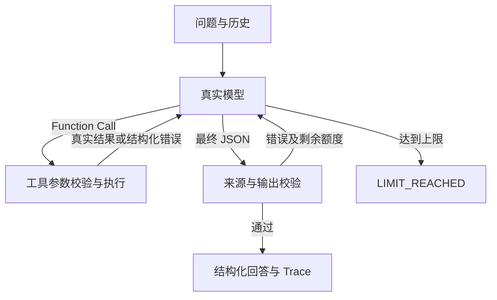

# 实现说明

## 模型与程序的职责

LiveModel 使用 OpenAI SDK Chat Completions。模型每轮接收全部可观察消息，
tool_choice=auto；搜索、换词、读取、补查、澄清和结束均由模型决定。
SDK 自动重试为 0，避免“固定重试”掩盖调用计数；API 超时默认 45 秒，可配置。
模型正文只作为工具请求或最终 JSON。MiniMax 要求的 reasoning_content 仅在内存中续接回传，
不写入 Trace 或用户输出；OpenAI 兼容路径不额外注入此字段。

Agent 只执行模型选择、维护上限、回传观察和验证输出。没有按报销主题或文档 ID 分支的生产逻辑。
MockModel 有明确的固定步骤和合成模式规则，属于测试基础设施，不是 Live 实现。

## 数据、检索与冲突

Corpus 使用 JSONL 外部文件，通过文件 SHA-256 识别变更，原子替换内存索引状态。
数据校验检查必须字段、日期、重复 ID/片段和 supersedes 环。
BM25 使用 jieba；字符通道用连续汉字/英数字片段的 2/3-gram，保留标点和字段边界。
词法候选去除通用词；字符候选需至少两个重合 gram 且覆盖分数不低于 0.12。
RRF 使用每路排名的 1/(60+rank) 相加；精确 ID / 完整标题额外优先。

Improved 将首个命中主题的竞争文档代表片段优先纳入 top_k，并提供所有命中主题的 related_documents 元数据。
top_k 仍是硬边界，元数据不含额外完整原文，不可直接引用。
Baseline 不启用字符融合和主题扩展。两路比较保持同一分词、停用词和精确匹配能力。
检索器不判断冲突。模型须比较条款、scope、supersedes，不得从日期或分数推出有效性。

## 证据门禁

EvidenceValidator 校验结构、真实文档、所属片段、版本、精确引用和本轮读取证明。
读取记录保存实际 text、版本、范围、替代关系；即使版本日期未改，文字变化也会使旧读取失效。
已删除来源无法被引用。成功读取和搜索会发现同主题候选，候选未核查时阻止正式结论。
工具错误、JSON 错误、非法参数均作为观察反馈；非法最终引用也反馈模型，在剩余轮次内修正。
如果仍不合法，返回 LIMIT_REACHED，而不是替模型补写引用。

来源校验不等于语义正确。测试特意构造“真实 30 天引文 + 错误 90 天回答”：
来源验证器会接受该引文，而独立事实检查会拒绝回答。
这明确了工程保证的边界，不能用字符串子串校验冒充完整语义评测。

## 历史、安全和状态

历史仅允许 user/assistant，不能注入额外 system/tool 角色；每轮有独立读取账本。
文档内的指令始终处于 tool 数据通道；System Prompt 明确不执行文档指令。
这只能证明通道隔离，真实模型能否抵抗注入必须由 Live 案例验证。
API 异常只记录异常类名；不保存异常原文、API Key 或 SDK 原始响应。

运行时计数覆盖模型提供的 task_state，避免模型伪造完成或调用次数。
ANSWERED / NOT_FOUND 表示当前查询已结束；CONFLICT / NEEDS_CLARIFICATION 需要用户进一步输入；
TOOL_ERROR / LIMIT_REACHED 明确未完成。NOT_FOUND 不代表“企业没有该规定”，仅指当前资料未检得依据。

## 技术取舍

未使用向量库、数据库或 Agent 框架，便于审计模型和工具边界。
小语料每次计算文件哈希可接受；大语料需要快照和索引管理，不在本题范围。
标准库承担 CLI、JSON、文件、类型和 Trace；额外依赖只有 SDK、jieba、BM25、dotenv 和 pytest。
